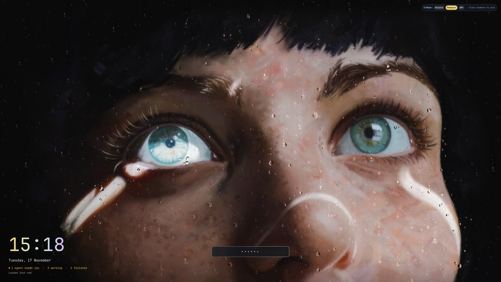
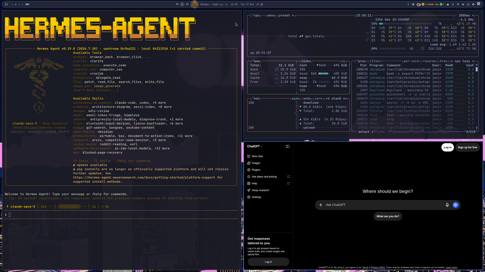
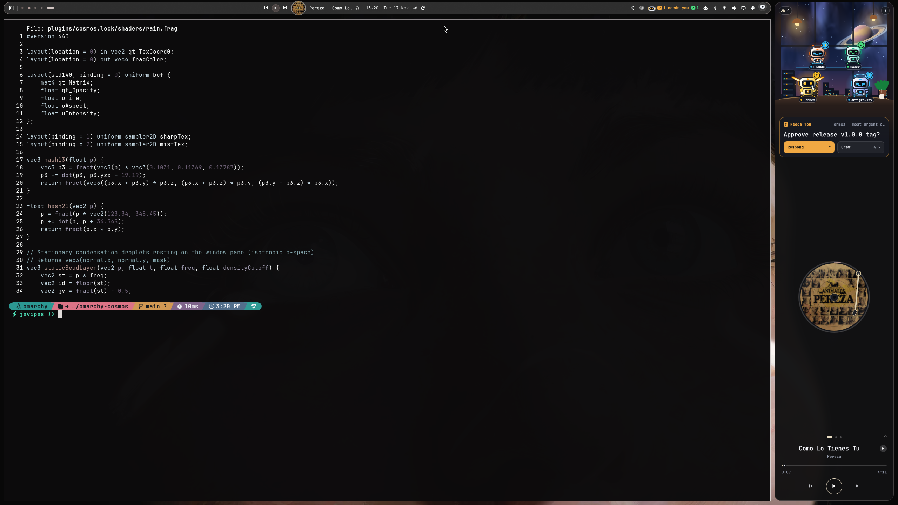
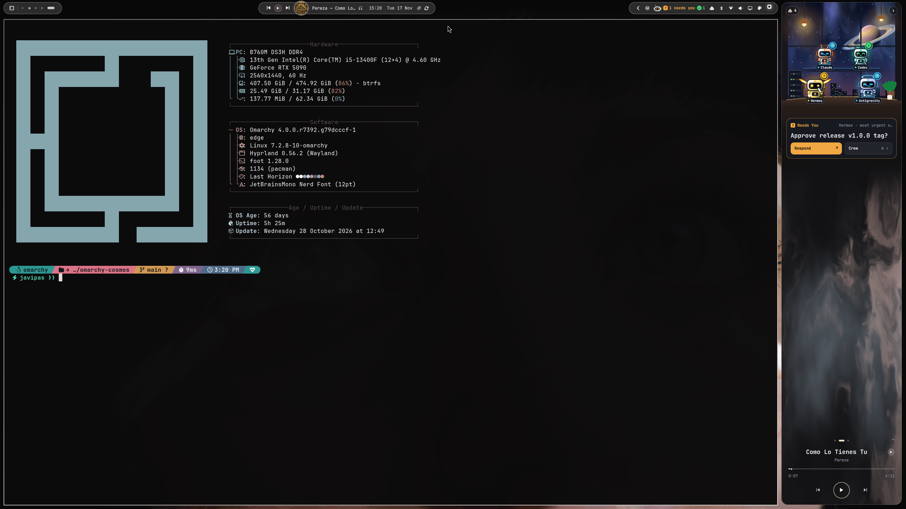
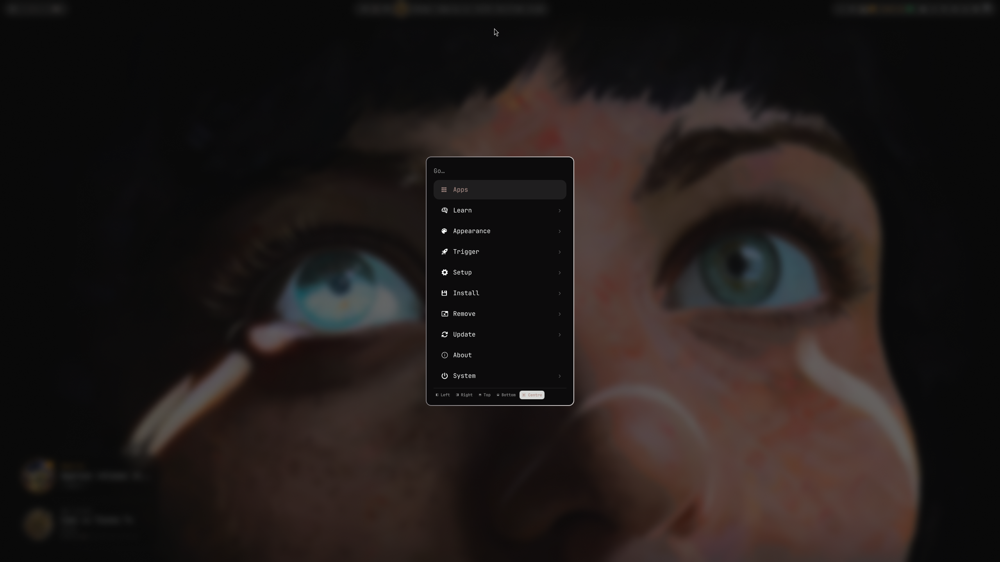
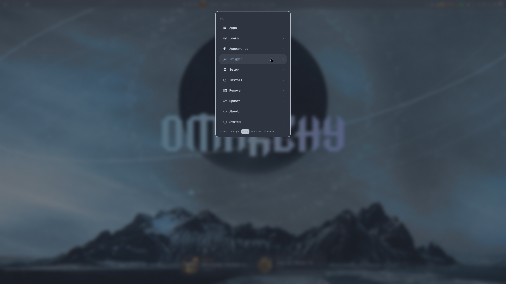
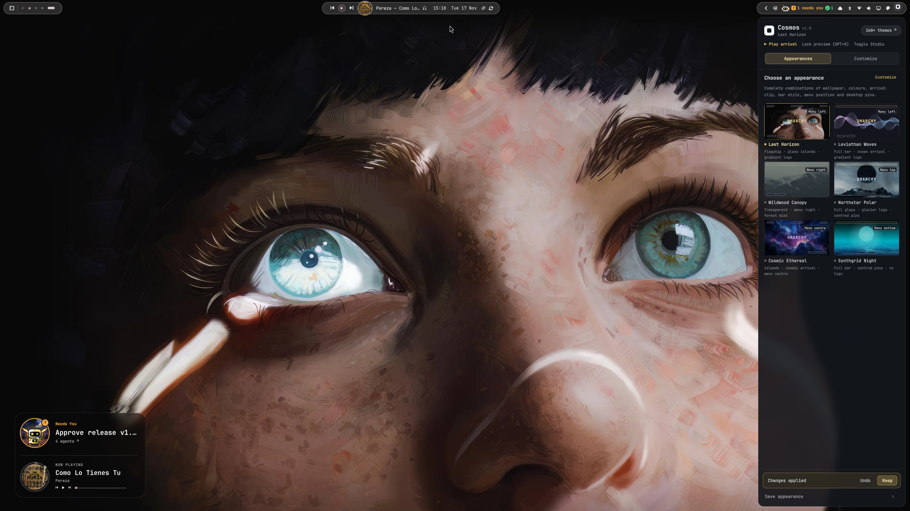
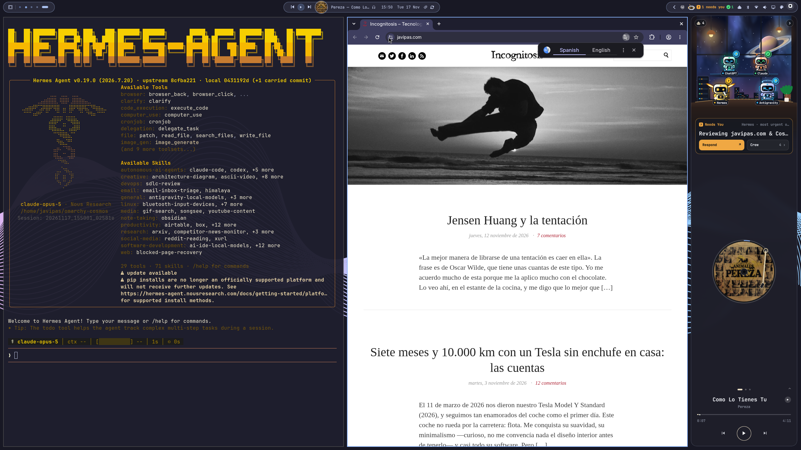

<div align="center">

# Omarchy Cosmos

**A live AI-native, shader-powered desktop suite for Omarchy 4.x**

[](https://omarchy.org)
[](#features)
[](#keyboard-shortcuts)
[](./LICENSE)

<br />

<a href="./assets/screenshots/08-optical-rain-lockscreen.png">
  
</a>

*Real-time GPU optical droplet refraction (`Drizzle / Downpour / Clear`) · pastel gradient clock · live AI agent activity summary*

</div>

---

**Omarchy Cosmos** is a lightweight, 100% open-source (`MIT`) desktop suite for **Omarchy 4.x** (`quickshell` + `hyprland` + `owe` + `qt6-shadertools`).

Every plugin, GLSL shader, procedural QML scene, and local watcher daemon is built natively on top of Omarchy's official plugin architecture (`~/.config/omarchy/plugins/`) without modifying `/usr/share/omarchy/`.

---

## Screenshots

> Click any image to view it at native **2560×1440** resolution.

### Multi-Agent Tiling Workflow

<a href="./assets/screenshots/02-workflow-hermes-btop-chatgpt.png">
  
</a>

*Full-width frosted `Bar` (`Tokyo Night`) · **Hermes Agent** + `btop` telemetry + **ChatGPT** client tiled in Hyprland dwindle, with live agent status pills in the top-right bar.*

### Desktop Modules, Themes & Shaders

<table>
  <tr>
    <td width="50%" valign="top">
      <a href="./assets/screenshots/03-cosmos-studio-robots-vinyl.png">
        
      </a>
      <p align="center"><b>Cosmos Studio &amp; Vinyl Turntable</b><br /><sub>Procedural Mecha-Chibi robots for Claude, Codex, Hermes &amp; Antigravity + spinning MPRIS vinyl player</sub></p>
    </td>
    <td width="50%" valign="top">
      <a href="./assets/screenshots/04-starship-fastfetch-aurora.png">
        
      </a>
      <p align="center"><b>Aurora Player &amp; Starship Prompt</b><br /><sub><code>Islands</code> capsules, 2-line Pastel-Powerline Starship prompt, and Aurora shader media mode</sub></p>
    </td>
  </tr>
  <tr>
    <td width="50%" valign="top">
      <a href="./assets/screenshots/05-menu-center-palette.png">
        
      </a>
      <p align="center"><b>Cosmos Menu — Center Floating Palette</b><br /><sub>Full-screen Gaussian blur with instant live switching across 5 positions (<code>Left · Right · Top · Bottom · Centre</code>)</sub></p>
    </td>
    <td width="50%" valign="top">
      <a href="./assets/screenshots/06-northstar-top-menu-wordmark.png">
        
      </a>
      <p align="center"><b>Northstar Polar &amp; Top Slide Menu</b><br /><sub><code>Nord</code> palette, <code>Solid Glass</code> bar, centered desktop pins, and glacier pixel-art <code>OMARCHY</code> wordmark</sub></p>
    </td>
  </tr>
  <tr>
    <td width="50%" valign="top">
      <a href="./assets/screenshots/07-appearances-settings-drawer.png">
        
      </a>
      <p align="center"><b>Appearances &amp; Settings Drawer</b><br /><sub>6 curated visual profiles, 260+ Omarchy themes integration, custom snapshots, and live <code>Undo / Keep</code> preview bar</sub></p>
    </td>
    <td width="50%" valign="top">
      <a href="./assets/screenshots/01-hero-hermes-browser-studio.png">
        
      </a>
      <p align="center"><b>Hermes Agent, Browser &amp; Cosmos Studio</b><br /><sub><code>Islands</code> frosted-glass bar, <b>Hermes Agent</b> + Chromium side-by-side, and live AI crew + vinyl player</sub></p>
    </td>
  </tr>
</table>

---

## Features

- **`cosmos.bar` & `cosmos.workspaces`** — Multi-mode frosted-glass top bar (**Bar**, **Islands**, **Solid Glass**, **Transparent**) with adaptive contrast, dynamic workspace capsules with per-app glyphs, and window stash/restore controls.
- **`cosmos.studio` & `cosmos.agent-pill`** — Live AI Agent Command Center side drawer, empty-desktop status pins, and top-bar status pill. Monitors **Antigravity**, **Claude Desktop / Claude Code**, **ChatGPT Desktop**, **Codex**, and **Hermes Agent** (`~/.hermes/state.db`) locally via `cosmos-agent-watcher` with zero external network calls, rendering custom procedural **Mecha-Chibi robots** that react in real time (`working`, `needs_you`, `finished`).
- **`cosmos.vinyl-media`** — Spinning MPRIS vinyl disc pill in the top bar + integrated **Vinyl Turntable** / **Aurora** / **Minimal** media player inside Cosmos Studio, paired with a centered floating YouTube Music toggle.
- **`cosmos.menu`** — 5-layout Omarchy Menu & Launcher replacement (**Left**, **Right**, **Top**, **Bottom**, **Centre**) with instant live layout switching and system telemetry footer.
- **`cosmos.lock`** — Custom GPU-accelerated optical rain refraction shader (`rain.frag.qsb` with **Drizzle / Downpour / Clear** modes) and theme-reactive gradient clock (`gradient_clock.frag.qsb`).
- **`cosmos.background`** — Optional pixel-art `OMARCHY` gradient wordmark overlay (`logo_gradient.frag.qsb`, toggleable anytime with multiple palette styles) + `owe` one-shot Arrival video wallpaper transitions.
- **`cosmos.settings`** — Right-side **Appearances & Settings** drawer with 6 curated theme presets, custom appearance snapshots, live **Undo / Keep** preview bar, and unified **Customize** controls (`cosmos-ctl settings customize`) for bar, menu, pins, rain, arrival videos, and wallpaper wordmark.
- **`config/starship-cosmos.toml`** *(optional)* — Two-line Pastel-Powerline Starship prompt with OS, path, Git branch/status, language runtimes, and command duration capsules.

---

## Requirements

- **Omarchy Linux 4.x** (`omarchy-shell` / `quickshell`, `hyprland`, `playerctl`, `python3`)
- Optional: `omarchy-wallpaper-engine` (`owe`) for animated Arrival wallpapers, `starship` for the optional terminal prompt.

---

## Installation

Clone the repository anywhere and run `./install.sh`:

```bash
git clone https://github.com/picajoso/omarchy-cosmos.git
cd omarchy-cosmos
./install.sh
```

To also install the 2-line Pastel-Powerline Starship prompt (`~/.config/starship.toml`, backing up any existing file to `~/.config/starship.toml.bak.cosmos`):

```bash
./install.sh --with-starship
```

### Uninstall (Restore Stock Omarchy)

```bash
./uninstall.sh
```

---

## Keyboard Shortcuts

Designed with single-modifier `SUPER` bindings (friendly for both native keyboards and remote VNC / Mac `OPT` remaps):

| Shortcut | Action |
| :--- | :--- |
| `SUPER + SPACE` | Open Cosmos Menu / App Launcher |
| `SUPER + E` | Cycle Menu layout (`Left` → `Right` → `Top` → `Bottom` → `Centre`) |
| `SUPER + B` | Cycle Top Bar style (`Bar` → `Islands` → `Solid Glass` → `Transparent`) |
| `SUPER + D` | Toggle **Cosmos Studio** side panel (AI Robots + Turntable) |
| `SUPER + N` | Jump directly to the most urgent AI agent window |
| `SUPER + Z` | Toggle **Appearances & Settings** drawer |
| `SUPER + R` | Preview **Rain Lock Screen** (press `ESC` to close preview) |
| `SUPER + .` | Toggle `OMARCHY` pixel-art wallpaper wordmark |
| `SUPER + Y` | Toggle centered floating YouTube Music window |
| `SUPER + S` | Show / restore desktop windows |
| `SUPER + H` / `SUPER + U` | Stash active window / restore last stashed window |

---

## Repository Structure

```text
omarchy-cosmos/
├── assets/
│   └── screenshots/           # 2560x1440 desktop & workflow screenshots
├── bin/
│   ├── cosmos-ctl             # State, IPC, window & appearance controller CLI
│   └── cosmos-agent-watcher   # Read-only local AI agent state daemon
├── config/
│   └── starship-cosmos.toml   # Optional 2-line Pastel-Powerline Starship prompt
├── hypr/
│   └── cosmos.lua             # Hyprland glass layer rules & SUPER keybindings
├── plugins/
│   ├── cosmos.agent-pill/     # Top-bar live AI agent status pill
│   ├── cosmos.background/     # Wallpaper + optional gradient wordmark overlay
│   ├── cosmos.bar/            # 4-mode adaptive frosted-glass bar
│   ├── cosmos.lock/           # Optical GLSL rain & gradient clock lock screen
│   ├── cosmos.menu/           # 5-mode launcher & system menu drawer
│   ├── cosmos.settings/       # Appearances & live customization drawer
│   ├── cosmos.studio/         # Mecha-Chibi AI Studio & Vinyl/Aurora player
│   ├── cosmos.vinyl-media/    # Top-bar spinning MPRIS vinyl widget
│   └── cosmos.workspaces/     # Dynamic workspace & app-icon pills
├── install.sh                 # Portable installer & validator
├── uninstall.sh               # Clean stock-Omarchy restorer
└── LICENSE                    # MIT License
```

---

## License

Released under the [MIT License](./LICENSE) — Copyright © 2026 Javier Pastor.
